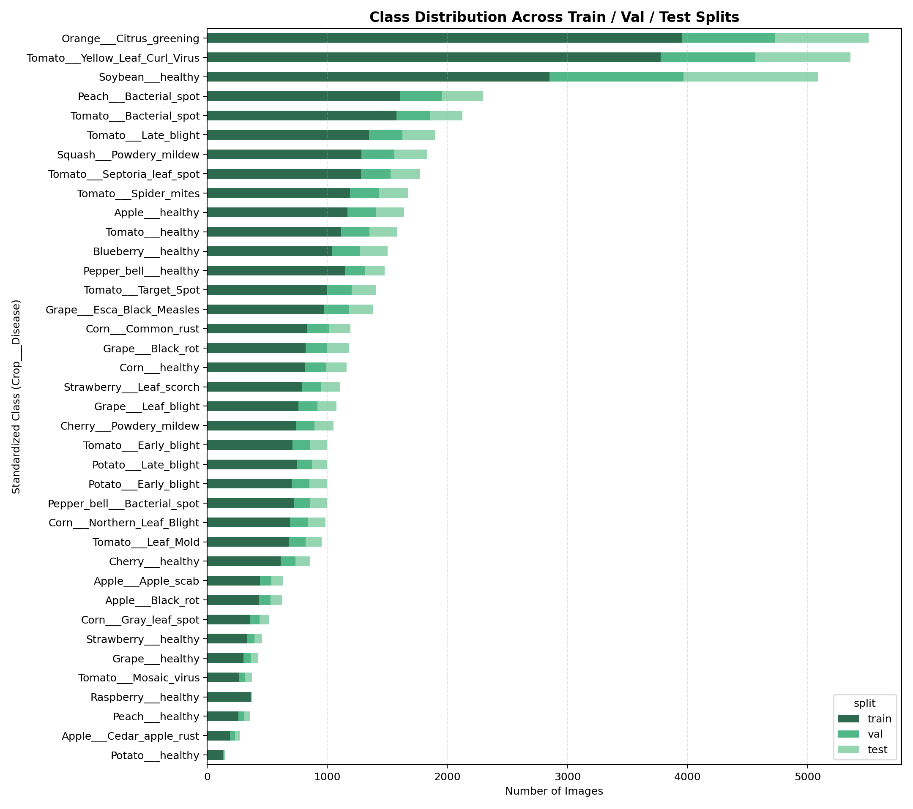
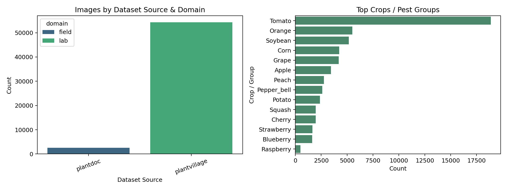
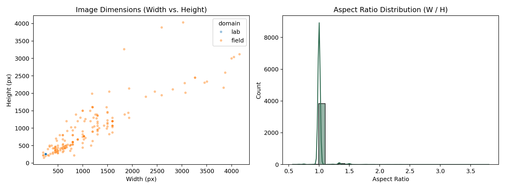
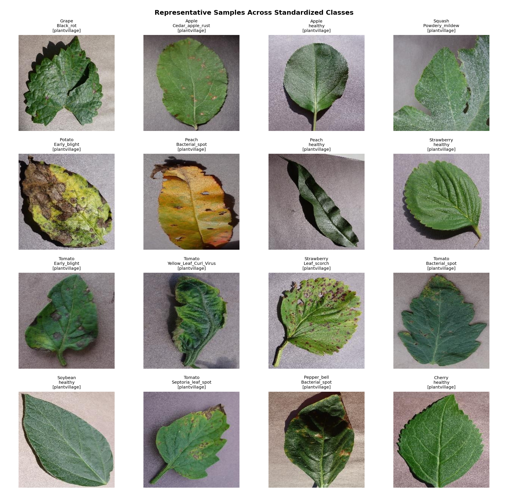

# Dataset Card — Crop Disease & Pest Classifier

## 1. Overview
- **Standardized Label Format**: `Crop___Disease` (or `Crop___healthy`, `Pest___<Name>`)
- **Total Scanned Raw Files**: 56,883
- **Removed (Corrupt / Too Small / Bad Aspect)**: 0
- **Removed Exact Duplicates (SHA-256)**: 33
- **Clean Catalog Size**: 56,850 images across **38** training classes
- **Unique Visual Clusters (pHash Hamming <= 6)**: 51,587
- **Train Imbalance Ratio (max / min class)**: 30.39x

## 2. Split Summary & Leakage Audit
| Split | Images | Domain Notes |
| --- | ---: | --- |
| `train` | 38,000 | Stratified group split (70% target) |
| `val` | 8,149 | Stratified group split (15% target) |
| `test` | 8,135 | Stratified group split (15% target) |
| `test_field` | 2,559 | Real-field PlantDoc evaluation set |

- **Leakage-Free Verification**: `True`
  - SHA-256 overlaps: `{'train_val': 0, 'train_test': 0, 'val_test': 0}`
  - Near-duplicate visual group overlaps: `{'train_val': 0, 'train_test': 0, 'val_test': 0}`
  - Cross-split pHash hits: `{'train_val': 0, 'train_test': 0, 'val_test': 0, 'train_field': 0}`

## 3. Exploratory Visualizations

## 4. Per-Class Counts
| Class (`Crop___Disease`) | Train | Val | Test | Field (`PlantDoc`) | In-Domain Total |
| --- | ---: | ---: | ---: | ---: | ---: |
| `Apple___Apple_scab` | 441 | 95 | 94 | 93 | 630 |
| `Apple___Black_rot` | 432 | 95 | 94 | 0 | 621 |
| `Apple___Cedar_apple_rust` | 191 | 42 | 42 | 88 | 275 |
| `Apple___healthy` | 1169 | 236 | 233 | 86 | 1638 |
| `Blueberry___healthy` | 1042 | 232 | 228 | 116 | 1502 |
| `Cherry___Powdery_mildew` | 737 | 158 | 157 | 0 | 1052 |
| `Cherry___healthy` | 611 | 125 | 118 | 57 | 854 |
| `Corn___Common_rust` | 834 | 179 | 179 | 116 | 1192 |
| `Corn___Gray_leaf_spot` | 359 | 77 | 77 | 68 | 513 |
| `Corn___Northern_Leaf_Blight` | 689 | 148 | 148 | 189 | 985 |
| `Corn___healthy` | 814 | 174 | 174 | 0 | 1162 |
| `Grape___Black_rot` | 821 | 179 | 180 | 64 | 1180 |
| `Grape___Esca_Black_Measles` | 973 | 205 | 205 | 0 | 1383 |
| `Grape___Leaf_blight` | 759 | 159 | 158 | 0 | 1076 |
| `Grape___healthy` | 301 | 61 | 61 | 69 | 423 |
| `Orange___Citrus_greening` | 3951 | 778 | 778 | 0 | 5507 |
| `Peach___Bacterial_spot` | 1607 | 345 | 345 | 0 | 2297 |
| `Peach___healthy` | 259 | 51 | 50 | 112 | 360 |
| `Pepper_bell___Bacterial_spot` | 720 | 139 | 138 | 71 | 997 |
| `Pepper_bell___healthy` | 1147 | 165 | 166 | 61 | 1478 |
| `Potato___Early_blight` | 705 | 148 | 147 | 117 | 1000 |
| `Potato___Late_blight` | 748 | 125 | 127 | 100 | 1000 |
| `Potato___healthy` | 130 | 10 | 12 | 0 | 152 |
| `Raspberry___healthy` | 362 | 4 | 5 | 119 | 371 |
| `Soybean___healthy` | 2850 | 1115 | 1125 | 65 | 5090 |
| `Squash___Powdery_mildew` | 1285 | 275 | 275 | 130 | 1835 |
| `Strawberry___Leaf_scorch` | 788 | 161 | 160 | 0 | 1109 |
| `Strawberry___healthy` | 330 | 64 | 62 | 96 | 456 |
| `Tomato___Bacterial_spot` | 1577 | 277 | 273 | 110 | 2127 |
| `Tomato___Early_blight` | 710 | 144 | 146 | 88 | 1000 |
| `Tomato___Late_blight` | 1349 | 276 | 276 | 110 | 1901 |
| `Tomato___Leaf_Mold` | 683 | 138 | 131 | 91 | 952 |
| `Tomato___Mosaic_virus` | 263 | 55 | 55 | 54 | 373 |
| `Tomato___Septoria_leaf_spot` | 1282 | 245 | 244 | 149 | 1771 |
| `Tomato___Spider_mites` | 1189 | 243 | 244 | 2 | 1676 |
| `Tomato___Target_Spot` | 1000 | 202 | 202 | 0 | 1404 |
| `Tomato___Yellow_Leaf_Curl_Virus` | 3776 | 790 | 791 | 75 | 5357 |
| `Tomato___healthy` | 1116 | 234 | 235 | 63 | 1585 |
